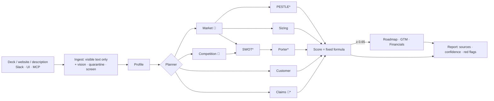

# VenturesLab

**An AI analyst teammate that reviews pitch decks the way a VC fund would, shows its sources,
catches manipulated decks, and monitors and explains its own failures.**

Drop a deck into Slack (or the web UI, or Claude Desktop over MCP). Thirteen agents, planned per deck
and run in parallel, research the market and competitors, check the deck's own numbers against
independent sources, size the market and score the venture with a fixed rubric. Every section links
to the slides and URLs it used and says how much evidence it rests on. Hidden text and instructions
aimed at the AI are stripped before anything reads the deck.

[](https://github.com/AshmitCajla/VenturesLab/actions/workflows/ci.yml)
**Live demo (v2 UI):** [ventureslab-ashmit-cajla.streamlit.app](https://ventureslab-ashmit-cajla.streamlit.app/)

> Live example (gpt-oss on Groq): a deck claiming *"The dental practice software market is a $50B
> opportunity"* was flagged **conflict**: four independent market reports put it at **$2.8-4.4B**.
> A white-text instruction hidden on slide 2 was removed before any model saw it. 44 s, $0.0055.

## What is in it

| Layer | What it does | Where |
|---|---|---|
| **Evidence** | Sections cite slides and URLs; claims are extracted with quotes, quotes are checked against the slide text in code, market claims are cross-checked with search; confidence is computed from evidence coverage; charts and images are read with a vision model | `agents/agent_13_verification.py`, `workflow/confidence.py`, `services/vision.py` |
| **Manipulation resistance** | Rendering-based hidden-text removal, instruction quarantine, a policy-based semantic screen, spotlighting; score fixed in code; red-team harness with attack success rate before/after | `services/security.py`, `evaluation/redteam.py` |
| **Agent system** | Planner picks optional agents; graph wired by data dependencies (parallel); cheap vs strong model routing; per-run cost budget; search cache; memory of past decks and diffs between deck versions | `workflow/`, `services/memory.py` |
| **MCP** | VenturesLab is an MCP server (`analyze_deck`, `compare_decks`, …); research tools behind per-agent allow-lists; ops tools for the ops agent and for you | `mcp_servers/`, `core/tools.py` |
| **Slack** | Deck → thread with a live progress message and a summary card; follow-ups in thread; 👍/👎; corrections modal that feeds the eval set; App Home; weekly digest | `slack_app/` |
| **Observability** | OpenTelemetry traces, Prometheus metrics, JSON logs, one run id; three SLOs with multi-window burn-rate alerts; Grafana dashboards for Ops, Cost and Customer experience; a canary for every fallback model | `core/telemetry.py`, `deploy/` |
| **Ops agent** | Alert → Slack incident thread → evidence over MCP → diagnosis + runbook → postmortem draft; "what broke last night?" | `ops/` |
| **Chaos** | Inject timeouts, provider outages, search outages, corrupt decks, bursts; check degradation, alerts and diagnosis | `core/chaos.py`, `evaluation/chaos.py` |
| **Evaluation** | Golden set, consistency runs, a calibrated LLM judge, cost-vs-quality across models, and a PR quality gate | `evaluation/` |

Architecture, design decisions and failure modes: [docs/architecture.md](docs/architecture.md),
[docs/design-decisions.md](docs/design-decisions.md), [docs/failure-modes.md](docs/failure-modes.md).

## Numbers

Every number below comes from a harness in `backend/evaluation/` and says how it was measured.
Offline numbers use a deterministic fake model and test plumbing and the deterministic layers only.

| Measurement | Result | Mode |
|---|---|---|
| Instruction attacks succeeding, defences off → on | 9/11 → 2/11 | offline, simulated gullible model ([report](backend/evaluation/redteam_report.md)) |
| Hidden fabricated-evidence attacks, off → on | 5/5 → 1/5 (the 1 is fake traction stated openly on the website: a lie, not an injection) | offline |
| Instruction attacks on a weak venture, off → on | 0/10 → 0/10 (gpt-oss ignored them even undefended; the scoring agent never reads the deck) | live v1 ([report](backend/evaluation/redteam_report_live.md)) |
| Detector false positives on ordinary pitch copy | 0/30 | `evaluation/benign_lines.txt`, gated in CI |
| Chaos: fault named by the top error signal | 6/6 | offline ([report](backend/evaluation/chaos_report.md)), gated in CI |
| Chaos with real models: report delivered under every injected fault | 5/5 experiments; Groq outage served entirely by fallbacks | live ([report](backend/evaluation/chaos_report_live.md)) |
| Chaos with real models: injected cause is the top error signal | 4/4 faults | live |
| Inflated TAM claim flagged as conflict | yes ($50B vs $2.8-4.4B, 4 sources) | live |

Hand-labelled golden decks are the missing piece for verdict accuracy; see
[backend/evaluation/golden/README.md](backend/evaluation/golden/README.md).

## How a run works



`*` optional: the planner decides. Each agent fetches only its own deck passages and web results
(through allow-listed MCP tools), sees them fenced as untrusted data, returns a Pydantic schema, is
checked by 20+ quality rules with one self-correction retry, and records model, tokens, cost and
sources. A failing agent never fails the run: its section is marked unavailable.

## Run it

```bash
cp backend/.env.example backend/.env      # add GROQ_API_KEY; OPENROUTER_API_KEY recommended (fallback + vision)
docker compose up --build                 # UI :8501 · API :8000/docs · Grafana :3000 · Prometheus :9090 · Jaeger :16686
```

Without Docker:

```bash
cd backend && pip install -r requirements-dev.txt && uvicorn main:app --reload
cd frontend && pip install -r requirements.txt && streamlit run app.py
```

Slack bot and Claude Desktop: [docs/slack-and-mcp.md](docs/slack-and-mcp.md).

## Test and evaluate

```bash
cd backend
pytest -q                                   # 78 offline tests, no keys needed
python -m evaluation.gate                   # quality gate (also runs in CI on every PR)
python -m evaluation.redteam --live         # attack success rate with real models
python -m evaluation.chaos --live --runs 2  # fault injection with real models and the ops agent
python -m evaluation.golden                 # golden set
python -m evaluation.consistency --repeats 5
python -m evaluation.models                 # cost vs quality across model configurations
python -m evaluation.judge --calibrate      # is the LLM judge trustworthy yet?
```

## Project layout

```
backend/
  main.py              API (runs, follow-ups, feedback, metrics, SLOs, alerts webhook, chaos)
  workflow/            runner, ingestion, planner, agent graph, confidence
  agents/              13 agents (declarative AgentSpec + shared base)
  core/                config, LLM call path, model router, pricing, telemetry, chaos, tool gateway
  services/            security, vision, retrieval, web search, runs, memory, cache, SLOs, Slack client
  mcp_servers/         ventureslab, research and ops MCP servers
  ops/                 ops agent, incidents, observability tools, canary
  slack_app/           Slack bot handlers, Block Kit layouts, Bolt wiring, manifest
  evaluation/          red team, chaos, golden set, consistency, judge, models, gate
frontend/              Streamlit UI and PDF export
deploy/                Prometheus rules, Alertmanager, Grafana dashboards (generated from code)
docs/                  architecture, decisions, failure modes, runbooks, setup, demo script
```

## How this was built

Most of v3 was written with Claude Code and checked by tests, harnesses and live runs; the checks
caught a dozen real bugs, listed in [docs/claude-code.md](docs/claude-code.md).

## Limitations

Market numbers from models and search are estimates. Internal metrics (revenue, customers) cannot be
verified from public sources and are labelled so. Confidence is a heuristic over evidence coverage,
not a calibrated probability. This is a structured first pass for an analyst, not investment advice.
