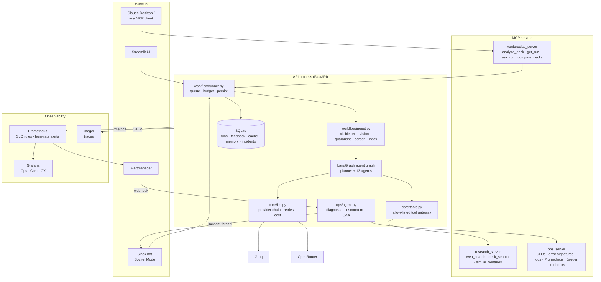

# Architecture

VenturesLab is one Python service (FastAPI) plus a Streamlit UI. The API process hosts the agent
graph, the Slack bot, the ops agent and the metrics endpoint, so one run id ties together a run's
database row, its log lines, its OpenTelemetry trace and its Slack thread.



## A run, step by step

1. **Queue.** `runner.execute` waits for a slot (`MAX_CONCURRENT_JOBS`), starts a `RunContext`
   (run id + cost budget) and an OpenTelemetry `run` span.
2. **Ingest** (`workflow/ingest.py`). For a deck: keep only text a human would see
   (`services/security.extract_visible_pages`), transcribe charts and images with a vision model
   (`services/vision.py`), remove lines that address the model (regex quarantine), then send the
   rest through the semantic screen (fast model + written policy). Website text gets the same
   quarantine and screen. The cleaned slides are chunked, embedded and indexed per run.
3. **Graph** (`workflow/graph.py`). The profile agent runs first, then the planner decides which
   optional agents are worth running. Every agent starts as soon as its own inputs are ready:

   ```
   understand -> plan -> market_research ----> pestle*, market_sizing
                      -> competition --------> swot* (+ market) -> porter*
                      -> customer_validation
                      -> claims*  (verification)
   [market_sizing, customer, porter, pestle, claims] -> scoring
   scoring >= 0.65 ? [roadmap || gtm || financials] : END
   ```

   Each agent (`agents/base.py`): retrieves its deck passages and web results through the tool
   gateway (only the tools its spec allows), fences them as untrusted data, calls the model through
   `core/llm.py`, runs its quality checks, retries once with the failures fed back, and records
   model, tokens, cost, sources and checks in the trace.
4. **Finalise.** Quality-check summary, per-section confidence (`workflow/confidence.py`),
   comparison with past runs (`services/memory.py`: similar ventures, and a diff against the
   previous version of the same company's deck), cost summary, persistence.

## Where the important rules live

| Rule | Code |
|---|---|
| Score = fixed weighted sum of five 1-10 ratings | `agents/agent_09_scoring.py` |
| Core agents cannot be skipped; planner only picks optional ones | `workflow/planner.py`, `workflow/graph.py` |
| Untrusted text is fenced; every prompt starts with the security preamble | `services/security.py`, `agents/base.py` |
| Citations must appear on the cited slide | `agents/agent_13_verification.py::citation_found` |
| An agent can only call the tools in its spec | `core/tools.py`, `AgentSpec.tools` |
| A failing agent never fails the run; dependents are skipped | `agents/base.py`, `workflow/runner.py` |
| Every LLM call records provider, model, tokens, cost | `core/llm.py`, `core/model_router.py` |
| Optional agents are skipped before the budget is exceeded | `agents/base.py`, `workflow/planner.py` |

## Data

One SQLite file (`DB_PATH`) holds `runs` (input, progress, result, Slack thread), `feedback`
(👍/👎 and corrections), `cache` (web search, 7-day TTL), `memory` (profile embeddings and result
snapshots) and `incidents`. Interfaces are small (`services/runs.py`, `services/cache.py`) so
Postgres can replace SQLite when there is more than one API instance.

## Processes

| Command | What |
|---|---|
| `uvicorn main:app` | API, Slack bot (if tokens are set), weekly digest scheduler |
| `streamlit run frontend/app.py` | UI |
| `python -m mcp_servers.ventureslab_server` | VenturesLab for Claude Desktop (stdio) |
| `python -m mcp_servers.ops_server` | ops tools for Claude Desktop (stdio) |
| `docker compose up --build` | all of the above plus Prometheus, Alertmanager, Grafana, Jaeger |
